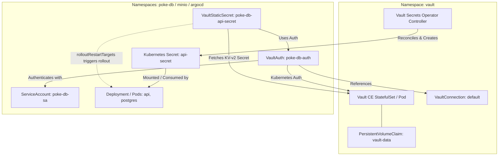

# Cluster GitOps (`cluster-gitops`)

This repository manages declarative Kubernetes manifests, platform services, and Argo CD configurations for homelab
operations and multi-application workloads including [PokeDB](https://github.com/JacobPotter/poke-db).

---

## Repository Structure

```
cluster-gitops/
├── .github/
│   └── workflows/
│       └── promote.yml                      # Production image promotion workflow (apps/poke-db/overlays/prod)
├── apps/                                    # Application workloads
│   ├── open-webui/                          # Open WebUI (Local AI chat interface)
│   │   ├── base/                            # Deployment, Service, PVC, HTTPRoute
│   │   └── overlays/
│   │       └── prod/                        # Production namespace and overlay
│   └── poke-db/                             # PokeDB application
│       ├── base/                            # Base Deployment, Service, ConfigMap, HTTPRoute, Postgres
│       │   ├── api.yaml                     # API Deployment and Service
│       │   ├── frontend.yaml                # Frontend Deployment and Service (nginx)
│       │   ├── httproute.yaml               # Envoy Gateway HTTPRoute
│       │   ├── postgres.yaml                # Postgres PVC, ConfigMap, Deployment, Service
│       │   ├── refresh-db-cronjob.yaml      # Nightly PokeAPI refresh (CronJob)
│       │   ├── refresh-db-seed-hook.yaml    # ArgoCD PostSync hook: seeds empty databases
│       │   ├── serviceaccount.yaml          # ServiceAccount (poke-db-sa)
│       │   ├── vault-auth.yaml              # VaultAuth referencing VaultConnection
│       │   ├── vault-secrets.yaml           # VaultStaticSecret CRDs for API and Postgres secrets
│       │   └── kustomization.yaml
│       └── overlays/
│           ├── prod/                        # Production pinned image tags (managed by CI)
│           └── preview/                     # Ephemeral PR preview base overlay
├── platform/                                # Cluster-wide platform infrastructure & routing
│   ├── argocd/                              # Declarative Argo CD configurations
│   │   ├── argocd-cm.yaml                   # Core Argo CD settings with external URL
│   │   ├── argocd-cmd-params-cm.yaml        # Server runtime parameters (insecure mode behind Gateway)
│   │   ├── argocd-rbac-cm.yaml              # RBAC policies
│   │   ├── argocd-notifications-cm.yaml     # Notification service, templates, triggers
│   │   ├── vault-auth.yaml                  # VaultAuth for Argo CD notifications
│   │   ├── vault-secrets.yaml               # VaultStaticSecret for GitHub App notifications credentials
│   │   ├── httproute.yaml                   # Argo CD HTTPS & LAN HTTPRoutes
│   │   └── kustomization.yaml
│   ├── gateway/                             # Envoy Gateway & HTTP Redirects
│   │   ├── gateway.yaml                     # Gateway definition (HTTP :80, HTTPS :443 + TLS cert)
│   │   ├── http-redirects.yaml              # Public HTTP-to-HTTPS 301 redirection route
│   │   └── kustomization.yaml
│   ├── minio/                               # MinIO S3 object storage
│   │   ├── deployment.yaml                  # Standalone MinIO deployment (Recreate)
│   │   ├── service.yaml                     # ClusterIP service (S3 API :9000, Console :9001)
│   │   ├── pvc.yaml                         # Persistent storage claim (10Gi RWO)
│   │   ├── vault-auth.yaml                  # VaultAuth for MinIO credentials
│   │   ├── vault-secrets.yaml               # VaultStaticSecret synchronizing minio-secret
│   │   └── kustomization.yaml
│   ├── vault/                               # HashiCorp Vault CE UI Gateway Routes
│   │   ├── httproute.yaml                   # Vault UI Gateway HTTPRoutes (HTTP & HTTPS)
│   │   └── kustomization.yaml
│   └── kustomization.yaml                   # Platform root kustomization
├── bootstrap/                               # Argo CD Root Applications
│   ├── vault.yaml                           # Official HashiCorp Vault Helm chart Application
│   ├── vault-secrets-operator.yaml          # Official HashiCorp VSO Helm chart Application
│   ├── open-webui.yaml                      # Application managing Open WebUI (apps/open-webui/overlays/prod)
│   ├── poke-db-prod.yaml                    # Production PokeDB Application
│   ├── poke-db-previews.yaml                # ApplicationSet for PR previews
│   ├── platform.yaml                        # Application managing platform/
│   └── minio.yaml                           # Application managing platform/minio/
├── scripts/
│   ├── init-vault.sh                        # Automated Vault initialization, unseal, policy, and seed script
│   └── setup-github-project.sh              # GitHub Projects v2 automation
└── README.md
```

---

## Secret Management with HashiCorp Vault & Vault Secrets Operator (VSO)

All sensitive credentials across `cluster-gitops` are managed in **HashiCorp Vault Community Edition (CE)** and automatically synchronized to Kubernetes Secrets via the **Vault Secrets Operator (VSO)**.

### Architecture



### Key Components

1. **Vault CE Server Helm Application (`bootstrap/vault.yaml`)**:
   - Deployed via official `hashicorp/vault` Helm chart as a single-replica StatefulSet in the `vault` namespace with a 10Gi PVC mounted at `/vault/data`.
   - File storage engine with UI enabled, exposed via ClusterIP Service `vault:8200` and Envoy Gateway routes (`vault.pttr-dev-lab`, `vault.webwizardssoftware.com`) declared in `platform/vault/httproute.yaml`.
   - Upstream Helm packaging maintains StatefulSet, ConfigMap, and Service lifecycle cleanly.

2. **Vault Secrets Operator Helm Application (`bootstrap/vault-secrets-operator.yaml`)**:
   - Deployed via official `hashicorp/vault-secrets-operator` Helm chart with `defaultVaultConnection` configured to the in-cluster Vault server.
   - Installs and manages VSO custom resource definitions (`VaultConnection`, `VaultAuth`, `VaultStaticSecret`, `VaultPKISecret`, `VaultDynamicSecret`).
   - Reconciles secrets continuously and updates native Kubernetes Secrets in workload namespaces.
   - Manages zero-downtime rolling updates via `rolloutRestartTargets` when secret values change in Vault.

3. **Authentication & Access Control**:
   - Workloads authenticate to Vault using Kubernetes ServiceAccounts (e.g., `poke-db-sa` in `poke-db` and `poke-db-pr-*`, `default` in `minio` and `argocd`).
   - Least-privilege ACL policies restrict workloads to read only their designated KV-v2 secret paths (`secret/data/<component>/*`).

### Bootstrap & Initialization Runbook

To initialize Vault on a fresh cluster, unseal the instance, enable the KV-v2 engine and Kubernetes auth, write ACL policies, configure auth roles, and seed baseline credentials:

```bash
# Execute the automated bootstrap script
./scripts/init-vault.sh
```

The script will:
- Initialize the Vault storage backend (1 share, threshold 1 for homelab/development).
- Save generated unseal keys and root token securely to `.vault-keys.json` (gitignored).
- Unseal the Vault instance.
- Enable the KV-v2 secrets engine at path `secret/`.
- Enable and configure the Kubernetes auth method using the in-cluster API server.
- Write ACL policies: `poke-db-policy`, `minio-policy`, and `argocd-policy`.
- Bind Kubernetes auth roles for ServiceAccounts across `poke-db`, ephemeral preview namespaces (`poke-db-pr-*`), `minio`, and `argocd`.
- Populate baseline secret key-values for `secret/poke-db/api`, `secret/poke-db/postgres`, `secret/minio`, and `secret/argocd/notifications`.

### Secret Rotation Workflow

To rotate a credential (for example, the database password):
1. Update the secret in Vault:
   ```bash
   vault kv put -mount=secret poke-db/api DB_PASSWORD="newpassword"
   ```
2. The Vault Secrets Operator detects the KV-v2 version update, reconciles the target Kubernetes Secret (`api-secret`), and automatically performs a rolling restart of target workloads specified in `rolloutRestartTargets`.

---

## Storage & Internal Services

### MinIO Object Storage
MinIO provides internal S3-compatible object storage for cluster workloads.

- **S3 API Endpoint**: `http://minio.minio.svc.cluster.local:9000`
- **Web Console Endpoint**: `http://minio.minio.svc.cluster.local:9001`
- **Console Access (Port-Forwarding)**:
  ```bash
  kubectl port-forward -n minio svc/minio 9001:9001
  ```
- **Credentials**: Synchronized from Vault (`secret/minio`) into `minio-secret` in namespace `minio` (`MINIO_ROOT_USER` and `MINIO_ROOT_PASSWORD`).

### Open WebUI (Local AI Interface)
Open WebUI provides a ChatGPT-compatible web interface connected to the host Ollama runtime.

- **Internal Service Endpoint**: `http://open-webui.open-webui.svc.cluster.local:8080`
- **Host Ollama Integration**: Connected to Ollama via downward API (`status.hostIP:11434`).
- **Persistent Storage**: Backed by a 10Gi RWO volume for sqlite metadata, chats, and user settings.
- **Routing**: Strictly internal LAN access via `http://open-webui.pttr-dev-lab`, `http://chat.pttr-dev-lab`, or `http://ai.pttr-dev-lab` (no external exposure).

---

## Traffic & Ingress Routing Flow

- **Public HTTPS Traffic (`*.webwizardssoftware.com`)**: Terminated on Envoy Gateway port 443 with TLS wildcard
  certificates and routed directly to backend services (`frontend:80`, `argocd-server:80`, `vault:8200`).
- **Public HTTP Redirection**: Port 80 requests for `*.webwizardssoftware.com` are upgraded via Gateway API
  `RequestRedirect` filter to `https://` with HTTP 301.
- **Internal LAN Traffic (`*.pttr-dev-lab`)**: Routes directly on port 80 over HTTP without forced redirection.

---

## Release & Promotion Flow

1. **Production Deployment (`promote.yml`)**:
   - When application code is merged to `main` in `JacobPotter/poke-db`, CI sends a `repository_dispatch` event
     (`promote-prod`) to this repository.
   - The `.github/workflows/promote.yml` workflow updates `apps/poke-db/overlays/prod/kustomization.yaml` with the new
     short SHA tags and commits the change to `main`.
   - Argo CD synchronizes `apps/poke-db/overlays/prod` and rolls out the updated containers into the `poke-db`
     namespace.

2. **Pull Request Preview Environments**:
   - The Argo CD ApplicationSet (`bootstrap/poke-db-previews.yaml`) monitors PRs in `JacobPotter/poke-db` labeled
     `preview`.
   - For each matching PR, an ephemeral environment `poke-db-pr-<N>` is created referencing
     `apps/poke-db/overlays/preview`, deploying PR-specific images (`:pr-<N>`), and exposing
     traffic under `pr-<N>.poke-db.pttr-dev-lab` and `pr-<N>.poke-db.webwizardssoftware.com`.
   - Removing the `preview` label or closing the PR automatically destroys the preview environment.

---

## Local Validation

Render all manifests locally with Kustomize:

```bash
# Applications
kubectl kustomize apps/open-webui/overlays/prod
kubectl kustomize apps/poke-db/overlays/prod
kubectl kustomize apps/poke-db/overlays/preview

# Platform & Ingress
kubectl kustomize platform/argocd
kubectl kustomize platform/gateway
kubectl kustomize platform/minio
kubectl kustomize platform/vault
kubectl kustomize platform/
```
