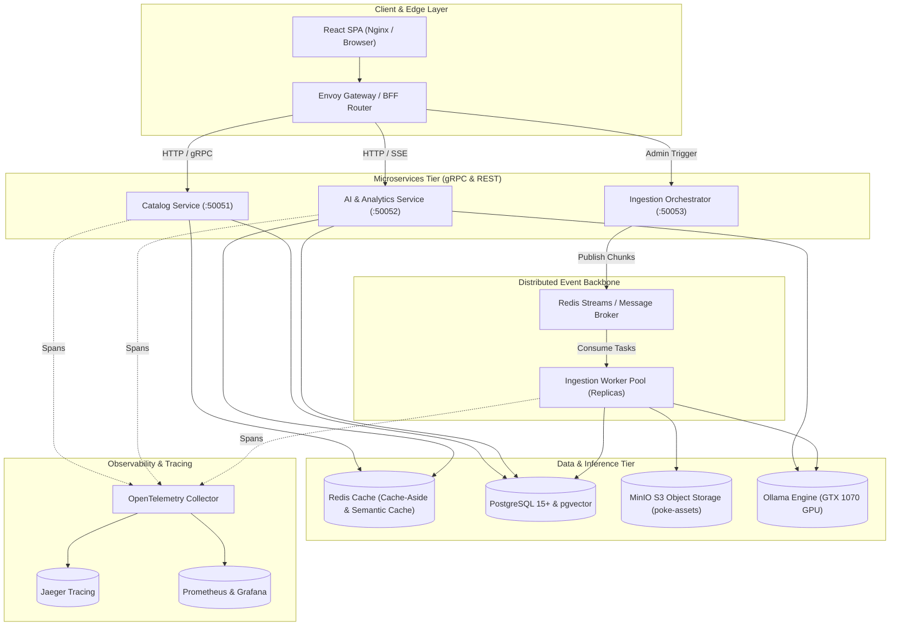
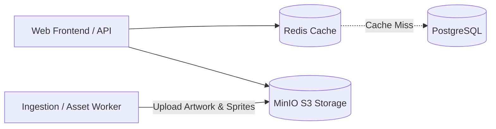
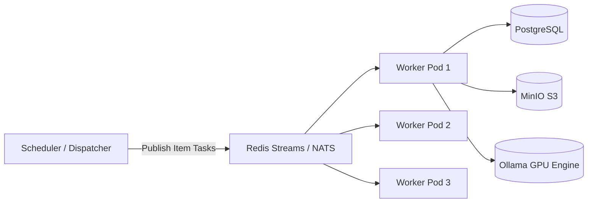
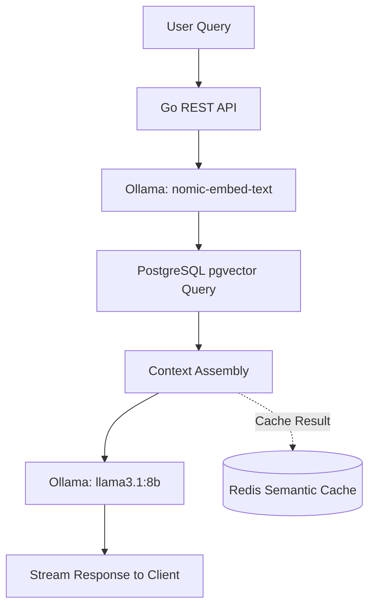
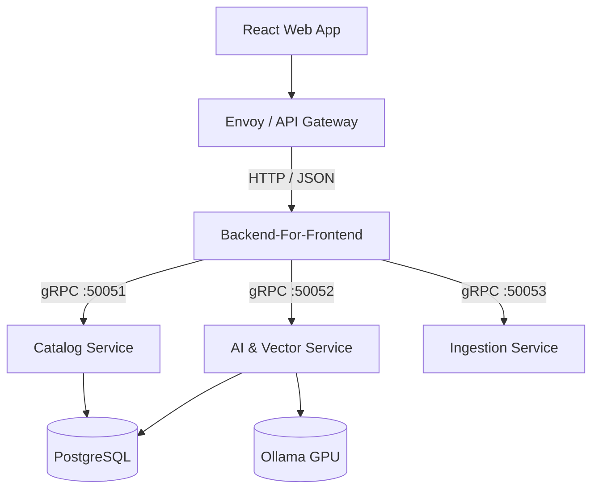
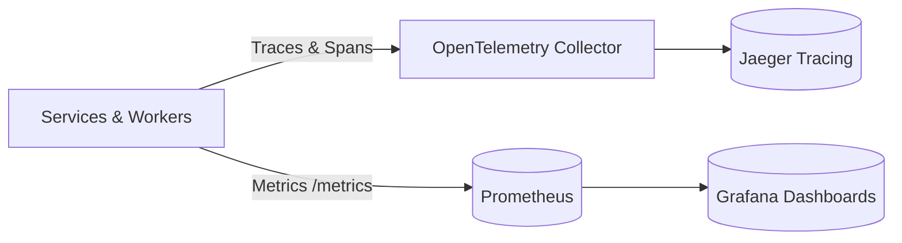
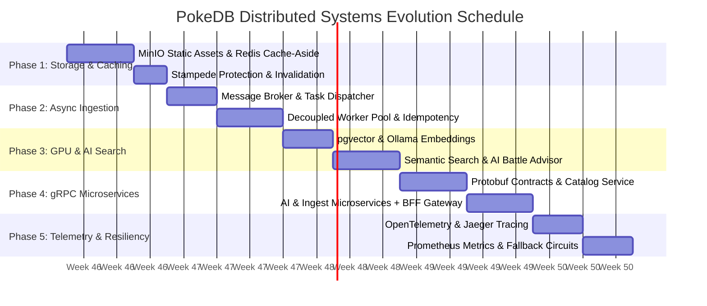

# PokeDB Distributed Systems Evolution & Practice Plan

## 1. Executive Summary & Goals

This project plan details the phased transformation of **PokeDB** from a traditional 3-tier client-server application (React SPA, Go REST API, PostgreSQL database) into a resilient, asynchronous, GPU-accelerated **distributed system**. 

The goal of this initiative is hands-on practice with production distributed systems patterns, including:
- **Object storage offloading & cache-aside caching**
- **Asynchronous event-driven ingestion with distributed worker pools**
- **Local GPU inference & vector search integration via Ollama and `pgvector`**
- **Microservice decomposition with binary `gRPC` / Protocol Buffer contracts**
- **Distributed tracing, metrics instrumentation, and fault tolerance**

---

## 2. Infrastructure & Compute Profile

The system leverages the local development environment (`potter-dev-lab`) and Kubernetes cluster (`cluster-gitops`) with the following compute profile:

| Subsystem | Specification / Allocation | Primary Roles |
| :--- | :--- | :--- |
| **GPU Acceleration** | **NVIDIA GeForce GTX 1070 (8,192 MiB VRAM)** Driver: 580.178.04 | - **Inference**: Quantized 7B–8B parameter LLMs (`llama3.1:8b-instruct-q4_K_M` / `qwen2.5:7b-instruct-q4_K_M` ~4.8 GiB VRAM) - **Embeddings**: `nomic-embed-text` (~500 MiB VRAM) for 768-dim embeddings - **VRAM Headroom**: ~2.5 GiB for KV cache context windows |
| **CPU & Concurrency** | **Intel Core i7-8700K (6 Cores / 12 Threads @ up to 4.7 GHz)** | - Dedicated worker pool threads for concurrent PokeAPI ingestion - Redis cache operations and PostgreSQL connection pooling - High-throughput gRPC and REST serialization |
| **Object Storage** | **MinIO S3 (`cluster-gitops/platform/minio`)** | - S3-compatible blob storage for Pokémon sprites, high-res artwork, and generated assets - Eliminates external runtime egress to pokeapi.co |
| **Relational & Vector DB**| **PostgreSQL 15+ with `pgvector`** | - Relational models, evolution trees, and HNSW vector index cosine search (`<=>`) |

---

## 3. Target Architecture Diagram

---

## 4. Phase-by-Phase Roadmap

### Phase 1: Blob Storage & Distributed Caching

**Objective**: Eliminate runtime dependencies on third-party CDNs, cut database read load by ~80%, and implement the cache-aside pattern.

- **Milestone 1.1: MinIO Static Asset Pipeline**
  - Create dedicated private bucket `poke-assets` in `MinIO`.
  - Update ingestion scripts to fetch artwork, animated sprites, and icons from PokeAPI and persist them to MinIO (`/pokemon/:id/front_default.png`, `/items/:id.png`).
  - Add API asset proxy endpoint `/api/v1/assets/*` (or direct S3 presigned URL support).
- **Milestone 1.2: Distributed Cache Layer with `Redis`**
  - Deploy Redis instance in Kubernetes via GitOps (`apps/poke-db/base/redis.yaml`).
  - Implement cache-aside in Go API for hot query paths:
    - Species profiles: `pokemon:{id_or_name}` (TTL: 24h).
    - Type damage relations: `types:matrix` (TTL: 7 days).
    - Evolution trees: `evolution:{chain_id}` (TTL: 24h).
- **Milestone 1.3: Cache Stampede Protection & Invalidation**
  - Implement distributed mutex / single-flight request coalescing on cache misses.
  - Implement event-driven key invalidation on database update or manual refresh.

---

### Phase 2: Asynchronous Distributed Ingestion Pipeline

**Objective**: Deconstruct the sequential, blocking `refresh-db` cron job into a distributed producer-consumer worker pipeline with retries, dead-letter queues, and dynamic scaling.

- **Milestone 2.1: Message Broker & Contract Definition**
  - Deploy `Redis Streams` (or `NATS`) as the message backbone.
  - Define schema payloads (`SyncPokemonTask`, `SyncAssetTask`, `GenerateVectorTask`).
- **Milestone 2.2: Chunked Task Dispatcher**
  - Build dispatcher binary/service that queries PokeAPI index and publishes granular chunk tasks into consumer groups.
- **Milestone 2.3: Decoupled Worker Pool (`cmd/worker`)**
  - Build concurrent worker pods consuming from Redis consumer groups with automatic message acknowledgement (`XACK`).
  - Implement exponential backoff, rate limiting to respect upstream API limits, and Dead Letter Queue (`DLQ`) routing for unrecoverable errors.
  - Enforce idempotency on database writes using `UPSERT` (`ON CONFLICT DO UPDATE`).

---

### Phase 3: GPU-Accelerated AI & Semantic Search (Ollama Integration)

**Objective**: Utilize the local GTX 1070 GPU (8GB VRAM) and Ollama to add vector similarity search and an AI-powered battle advisor to PokeDB.

- **Milestone 3.1: Vector Storage Setup (`pgvector`)**
  - Enable `pgvector` extension in PostgreSQL.
  - Create vector tables with HNSW indexing for Pokémon lore, competitive role summaries, and type match descriptions (768 dimensions).
- **Milestone 3.2: Asynchronous Vector Embedding Generation**
  - Ingestion pipeline worker sends textual Pokémon summaries to Ollama (`nomic-embed-text`) and stores vector embeddings in `PostgreSQL`.
- **Milestone 3.3: Semantic Search Endpoint (`/api/v1/search/semantic`)**
  - Convert natural language queries (e.g. *"Tanky water Pokémon immune to electric moves"*) to vector embeddings.
  - Perform cosine distance query (`ORDER BY embedding <=> query_vector LIMIT 10`) and return ranked results.
- **Milestone 3.4: AI Battle & Team Advisor Endpoint (`/api/v1/ai/advisor`)**
  - Connect API to Ollama running `llama3.1:8b-instruct-q4_K_M`.
  - Implement Retrieval-Augmented Generation (RAG): assemble Pokémon stats, movepools, and weakness matrices into context prompt, streaming response via Server-Sent Events (SSE).
  - Add Redis semantic / prompt-hash response caching to eliminate redundant GPU computation on identical team queries.

---

### Phase 4: Service Decomposition & High-Efficiency gRPC Contracts

**Objective**: Break down the monolithic Go API into distinct microservices communicating over binary Protocol Buffer RPCs.

- **Milestone 4.1: Protobuf Contracts (`api/proto/`)**
  - `catalog.proto`: Low-latency queries for species, moves, abilities, and evolution trees.
  - `ai.proto`: RPCs for `GenerateEmbeddings`, `SemanticSearch`, and `StreamBattleAdvice`.
  - `ingest.proto`: Job management, pipeline trigger, and ingestion progress telemetry.
- **Milestone 4.2: Microservice Implementation**
  - **Catalog Service**: Optimized Go service dedicated to high-throughput read operations backed by Redis and Postgres.
  - **AI & Analytics Service**: Coordinates Ollama GPU tasks, vector queries, and context formatting.
  - **Ingest Service**: Manages background job coordination, worker status, and MinIO uploads.
- **Milestone 4.3: API Gateway & BFF Composition**
  - Thin API Gateway / Backend-For-Frontend translating external HTTP/REST and SSE requests into internal gRPC calls.

---

### Phase 5: Distributed Observability & Resiliency

**Objective**: Provide complete operational visibility, distributed tracing across network boundaries, and graceful degradation during partial outages.

- **Milestone 5.1: Distributed Tracing with OpenTelemetry**
  - Inject W3C TraceContext headers across HTTP requests, gRPC metadata, and Redis Stream messages.
  - Deploy `Jaeger` to visualize distributed trace lifecycles from frontend requests through gRPC services, database queries, and GPU inference.
- **Milestone 5.2: Metrics & GPU Utilization Dashboards**
  - Expose Prometheus metrics: worker queue depth, latency histograms, cache hit/miss ratios, gRPC error rates, and GPU VRAM/temperature metrics.
- **Milestone 5.3: Fault Tolerance & Graceful Degradation**
  - Implement circuit breakers and fallbacks: if the GPU/Ollama engine is saturated or unreachable, semantic search gracefully falls back to PostgreSQL standard full-text search without client errors.

---

## 5. Value & Practice Progression Matrix

| Step | Milestone | Core Technologies | Key Distributed System Practice |
| :--- | :--- | :--- | :--- |
| **1** | **Asset Store & Caching** | `MinIO`, `Redis` | Cache-aside pattern, S3 object persistence, cache stampede mitigation |
| **2** | **Distributed Ingestion** | `Redis Streams`, Go Workers | Producer-consumer concurrency, task partitioning, backpressure, idempotency |
| **3** | **GPU AI & Semantic Search**| `Ollama`, `pgvector`, `llama3.1` | Vector indexing, RAG pipelines, local hardware acceleration, semantic caching |
| **4** | **gRPC Service Split** | `Protobuf`, `gRPC`, Envoy | Microservice boundaries, binary RPC serialization, API composition |
| **5** | **Telemetry & Resiliency** | `OpenTelemetry`, `Jaeger`, `Prometheus` | Context propagation, distributed tracing, metrics, circuit breakers |

---

## 6. Agile Execution Framework: Lean Flow / Scrumban

To optimize engineering throughput, eliminate non-value-adding administrative friction, and maximize knowledge acquisition as a solo engineer paired with AI, the project follows a **Lean Flow / Scrumban** methodology.

### 6.1 Core Operational Principles
- **Ceremony-Free Efficiency**: Eliminates fixed sprint planning overhead, artificial point estimations, and standups. 100% of available capacity is dedicated to architecture, implementation, debugging, and verification.
- **Strict Work-In-Progress (WIP) Limit (`WIP = 1`)**: Single-task focus avoids cognitive thrashing across complex distributed boundaries. A task must pass automated and GitOps verification before pulling the next item.
- **AI Pair Programming Dynamic**: AI functions as an always-available pair programmer for rapid boilerplate generation, Protobuf contract drafts, test matrix generation, and PR reviews, while the engineer leads architecture, system invariants, and runtime verification.
- **Milestone-Driven Value Realization**: Progress is governed by delivering verified functional capabilities (e.g., zero external asset dependencies, asynchronous task ingestion, local LLM streaming inference) rather than arbitrary time boxes.

---

## 7. Timeline, Capacity Budget & Operational Schedule

### 7.1 Engineering Capacity Profile
- **Daily Availability**: 6–8 hours/day (7 days/week).
- **Weekly Capacity**: 42–56 productive engineering hours/week.
- **Total Project Effort**: 160–210 engineering hours.
- **Estimated Duration**: **3.5 to 4.5 weeks**.

### 7.2 Project Schedule (Gantt)

### 7.3 Week-by-Week Milestone Breakdown

| Period | Phase & Focus | Target Hours | Primary Delivered Outcomes |
| :--- | :--- | :--- | :--- |
| **Week 1** | **Phase 1 + Phase 2 Start** - MinIO bucket `poke-assets` & asset downloader - Redis cache-aside (species, types, evolutions) - Redis Streams / NATS broker deployment | 45–50 hrs | Eliminates external PokeAPI runtime read latency; reduces PostgreSQL query load by ~80%; provisions message backbone. |
| **Week 2** | **Phase 2 Finish + Phase 3** - Decoupled `cmd/worker` pool (retries, DLQ, idempotency) - `pgvector` & `nomic-embed-text` embeddings - `/api/v1/search/semantic` cosine query - `/api/v1/ai/advisor` (llama3.1 SSE streaming) | 45–50 hrs | Ingestion operates asynchronously without timeouts; GPU is actively leveraged for natural language search and AI strategy generation. |
| **Week 3** | **Phase 4** - Protobuf contracts (`catalog`, `ai`, `ingest`) - Microservices (`catalog-service`, `ai-service`, `ingest-service`) - Envoy / BFF composition layer | 45–50 hrs | Decouples monolithic codebase into isolated services with strongly typed binary RPC communication. |
| **Week 4** | **Phase 5 + Hardening** - OpenTelemetry distributed tracing & Jaeger - Prometheus metrics & GPU monitoring - Circuit breakers & fallback mechanisms | 35–45 hrs | Provides end-to-end distributed observability, performance analytics, and graceful degradation under load. |

### 7.4 Daily Operational Rhythm

| Block | Duration | Focus Area | Workflow & AI Interaction |
| :--- | :--- | :--- | :--- |
| **Block 1** | 3–4 hrs | **Core Architecture & Implementation** | High cognitive energy. Architect schemas, define Protobuf/Go interfaces, implement core logic, and generate test suites with AI pairing. |
| **Intermission** | 1–2 hrs | **Rest & Context Reset** | Step away from the workstation to prevent fatigue and sustain problem-solving clarity. |
| **Block 2** | 3–4 hrs | **Integration, GitOps & Runtime Verification** | Deploy via ArgoCD to local cluster, test failure injection, monitor GPU VRAM, write integration tests, and update documentation. |

---

## 8. GitHub Projects Board & Work Breakdown

The actionable work breakdown, user stories, acceptance criteria, custom field schema, and workflow automations are specified in:
- **Project Board Blueprint**: [`docs/github-projects-board.md`](github-projects-board.md)
- **Preview Environments**: Enabled per feature PR via ArgoCD ApplicationSets (`bootstrap/poke-db-previews.yaml`).
